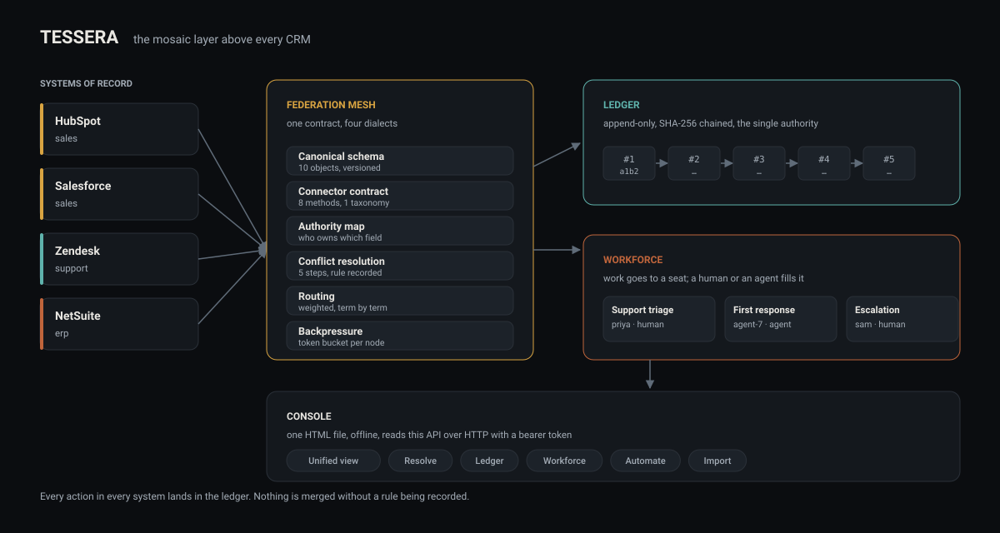

> ## Status: under development
>
> **Not finished, not released.** Published so the work can be inspected, not adopted. Version numbers are build
> numbers. Every GitHub release is flagged pre-release. Four claims in [CLAIMS.md](CLAIMS.md) are unverified, nine
> deliverables are partial, and the gate to leave this state is in [DEVELOPMENT.md](DEVELOPMENT.md).

<div align="center">

<h1>TESSERA</h1>

<p><b>The mosaic layer above every CRM.</b><br>
Every system you already run becomes a tile. The tiles keep their own shape.<br>
Together they make one picture &mdash; and one tamper-evident record of how the picture was made.</p>

<p>
<a href="https://drsamonline.github.io/tessera/"></a>


</p>

<p>
<a href="https://drsamonline.github.io/tessera/"><b>Landing page</b></a> &nbsp;&middot;&nbsp;
<a href="docs/index.md"><b>Documentation</b></a> &nbsp;&middot;&nbsp;
<a href="docs/audit/defect-register.md">Audit register</a> &nbsp;&middot;&nbsp;
<a href="docs/16-acceptance-criteria.md">Acceptance criteria</a> &nbsp;&middot;&nbsp;
<a href="docs/10-metrics.md">Metric dictionary</a> &nbsp;&middot;&nbsp;
<a href="docs/19-open-decisions.md">Open decisions</a> &nbsp;&middot;&nbsp;
<a href="https://drsamonline.github.io/">All projects</a>
</p>

<p><sub>Dual-licensed: free for noncommercial use under PolyForm Noncommercial 1.0.0, commercial by agreement &mdash;
<a href="COMMERCIAL.md">COMMERCIAL.md</a> &middot; &copy; 2026 Dr. Sohil Momin</sub></p>

</div>

---

> **Project status: a specification, a reference implementation that runs, and a demo that starts both halves.**
>
> **What runs today.** `python3 -m tessera.api` serves the HTTP API. `python3 -m tessera.demo` starts the API and the
> console together on free ports and prints one link that works. 748 tests pass. Every connector in the repository is
> checked against a 16-check suite, and the result is generated rather than typed
> ([CONFORMANCE.md](CONFORMANCE.md)). The Postgres DDL is parsed by Postgres's own parser
> ([docs/39](docs/39-postgres.md)).
>
> **What is still not true.** No connector has called a live tenant, every result comes from a recorded transport. The
> Postgres DDL has been parsed, never executed against a server. There is no hosted service, no multi-tenant
> deployment, and no customer has used this. The specification began as a 261-line build prompt and was audited
> against itself: 43 defects found, all 43 closed by formal definition or by a numbered assumption
> ([defect register](docs/audit/defect-register.md), [assumptions](docs/18-assumptions.md)).
>
> Every public claim and the check behind it is in [CLAIMS.md](CLAIMS.md). Where a figure is an estimate it says so on
> the line it appears.
>
> What does run: `tessera/`, a dependency-free reference implementation of the canonical schema, the ledger,
> the metrics, routing, conflict resolution, the connector contract, the conformance suite, four connectors and
> a working mesh, projections that rebuild from the ledger, the workforce layer, and an HTTP surface with an OpenAPI 3.1
> contract, ten MCP tools, three-layer access control a compliance substrate and local-first sync. 748 tests, standard library only, no network.
> An independent code review found 13 findings and fixed 11: [docs/31-code-review.md](docs/31-code-review.md).
> [What it does and does not do](docs/20-reference-core.md).

---

## What this is

Most companies run four to seven systems that each hold a slice of the same customer. The slices disagree.
Reconciling them costs a person a morning a week, and the reconciliation is invisible to everyone else.

TESSERA is the layer that sits above those systems instead of replacing them. Each connected system becomes a
node. The mesh presents one customer view across all of them, routes work to whichever node or person should
handle it, and writes every action in every system to a single hash-chained ledger. A native CRM is one node
in that mesh, not the product. Adoption is additive: the first result arrives before anything is migrated.

The design constraint that shapes everything else: one founder and a five-thousand-person organisation run the
same code paths. That bounds the architecture, not the customer list.

## Two ways to run it

**As a layer.** Point it at the CRMs a team already runs. Every field shows which system it came from and the rule
that chose it; nothing is merged without a rule being recorded.

**As the CRM.** `python3 -m tessera.demo --standalone` starts it with no external system at all. The native node is the
system of record, the console creates and edits records, and connecting a CRM later turns the same data into a
federated view. [docs/48-standalone.md](docs/48-standalone.md) states what standalone means and what it still is not.

## Run it

```bash
git clone https://github.com/drsamonline/tessera-app ../tessera-app
python3 -m tessera.demo
```

```
  API       http://127.0.0.1:8081   token demo-token
  Console   http://127.0.0.1:8080
  Open      http://127.0.0.1:8080/index.html?engine=http://127.0.0.1:8081&token=demo-token
```

Both halves, free ports, the console's origin added to the CORS allowlist, one link that works. The seed is six
contacts, four companies and four deals across three systems, enough to show agreement, authority, a case-only
difference and a record one system has never seen. [What the demo data contains](docs/47-running-it.md).

## Does it actually conform?

[CONFORMANCE.md](CONFORMANCE.md) is generated, not written: `scripts/conformance_report.py` runs the sixteen-check
suite against every connector in this repository and writes the result. `check_docs.py` fails the build if the
committed document does not match a fresh run, so it cannot drift into being a claim.

| Connector | Checks |
|---|---|
| HubSpot (CRM v3) | 16/16 |
| Salesforce (REST v60) | 16/16 |
| Zendesk (Support API v2) | 16/16 |
| Native (in-process) | 16/16 |

All four run against recorded transports. No connector here has called a live tenant.

## How it fits together



## Why the name

A *tessera* was a single tile in a Roman mosaic, and separately a token of identity carried by a citizen to
prove standing. Both meanings are load-bearing here. Each connected system is a tile that keeps its own shape
and its own identity; the mesh is what makes them a picture; and the ledger is the proof of standing &mdash;
what each system knew, when it knew it, and who acted on it.

The name is deliberately outside the textile family already used elsewhere in this fleet. TESSERA is a mosaic,
not a loom.

## The three rules that do not bend

1. **No AI in the critical path.** Read, write, sync, auth, search, report and notification work with every
   AI container switched off. The full test suite must pass at the bare profile.
2. **Nothing is silently overwritten.** A cross-system conflict resolves by a declared order and is written to
   the ledger with both candidate values and the rule that settled it.
3. **History has one authority.** The event ledger is the record. Everything else &mdash; bi-temporal columns,
   git checkpoints, graph projections &mdash; is derived and must be rebuildable from it.

Each rule has a test named in [the AI contract](docs/12-ai-contract.md) and
[the history ruling](docs/11-history-authority.md). A rule without a test is a slogan.

## The eight layers

| Layer | Name | v1 | What it does |
|---|---|---|---|
| 0 | Federation mesh | Yes | Nodes, canonical schema, connectors, routing, ledger, conflict resolution |
| 1 | CRM core | Yes, optional | Reference implementation of the canonical schema |
| 2 | Workforce | v1 subset | Seats, occupants, tasks, handoff, escalation, autonomy |
| 3 | Intelligence | v2 | Graduated autonomy, workforce analytics, cost-aware routing |
| 4 | Protocol and settlement | v3 | Cross-company chains, agent-to-agent transactions |
| 5 | Economic engine | v3 | Marketplace, outcome billing, revenue share |
| 6 | Experience | Yes | Design system, jargon discipline, migration as UX |
| 7 | Learning | Yes | Bootcamp, coach, academy, docs, changelog, community |
| &mdash; | Cross-cutting | Yes | Identity, observability, governance |

Layers 3 to 5 are roadmap with written entry criteria, not placeholders. The v1 specification covers the other
five plus cross-cutting concerns. [Why the split](docs/06-roadmap.md).

## What is in this repository

| Path | What it holds |
|---|---|
| `tessera/` | The reference implementation: canonical schema, ledger, metrics, routing, conflict resolution, connectors, mesh, API |
| `docs/` | Fifty-two documents, the specification, the audits, and the evidence |
| [docs/index.md](docs/index.md) | **The map.** Read these four, then jump to the task you have |
| [CONFORMANCE.md](CONFORMANCE.md) | Four connectors, sixteen checks, generated |
| [CLAIMS.md](CLAIMS.md) | Every public claim and the command that checks it |
| [AGENTS.md](AGENTS.md) | What an agent needs before touching the code |
| `scripts/` | The gates: docs freshness, links, claims, conformance, DDL, smoke |
| [deliverables/](deliverables/) | The same specification as PDF, DOCX and XLSX, for circulation |

The full document inventory is in [docs/index.md](docs/index.md), one place, so there is one list to keep true.

## Run it

```bash
python3 -m tessera.cli demo                  # two systems, one contact, one ledger, tamper detection
python3 -m tessera.cli mesh                  # three nodes, one picture, the activation event
python3 -m tessera.cli workforce             # seats, a signed handoff, revocation
python3 -m tessera.cli schema                # print and check both contracts
python3 -m tessera.cli timeline              # what we knew vs what was true, then revert and mirror
python3 -m tessera.bench --gate              # measure, and fail on a regression
python3 -m tessera.jargon                    # the lint that blocks release
python3 -m unittest discover -s tests -t .   # 748 tests
python3 -m tessera.fuzz                      # four property suites
python3 scripts/smoke.py                     # one call into every module
python3 scripts/check_docs.py                # docs and landing page match the tree
```

`demo` appends two writes from two systems, asks what each system knew at two different times, resolves the
conflict between them, routes the next write, computes the trust and relationship scores, verifies the chain,
then alters one byte and verifies again.

`mesh` registers three nodes, runs the conformance suite against each connector, syncs their records, prints
the unified view with provenance on every field, shows the one real disagreement with both values, evaluates
the activation event, writes a field back to the node that owns it, and verifies the chain.

No dependencies. Python 3.10 or later. Nothing reaches the network.

## Read this in ten minutes

1. [docs/01-product.md](docs/01-product.md) &mdash; who it is for and what the first result is.
2. [docs/02-architecture.md](docs/02-architecture.md) &mdash; the layer model and the boundaries between layers.
3. [docs/11-history-authority.md](docs/11-history-authority.md) &mdash; the one ruling that makes the rest coherent.
4. [docs/12-ai-contract.md](docs/12-ai-contract.md) &mdash; what the product refuses to do.
5. [docs/19-open-decisions.md](docs/19-open-decisions.md) &mdash; what is still open and needs a decision.

## Contributing

Read [CONTRIBUTING.md](CONTRIBUTING.md) first. This is a specification repository: documentation accuracy is
the product quality. A statement that contradicts verified reality is a defect, and it is reported the same way
a code bug is.

## Licence

PolyForm Noncommercial 1.0.0 ([LICENSE](LICENSE)) &mdash; source-available, not OSI-approved open source.
Commercial use needs a separate licence. Privacy: [PRIVACY.md](PRIVACY.md). Security: [SECURITY.md](SECURITY.md).
